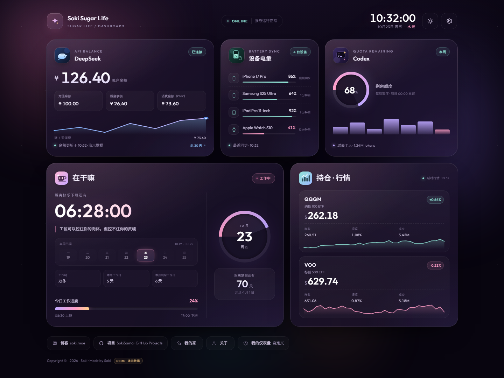
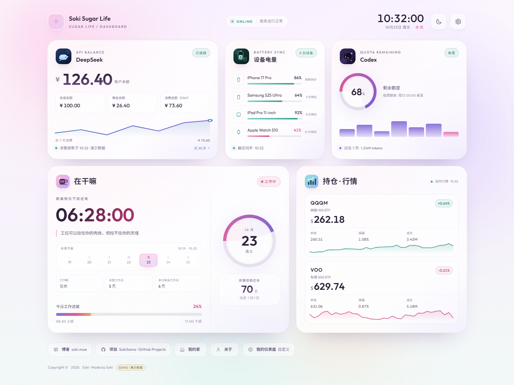
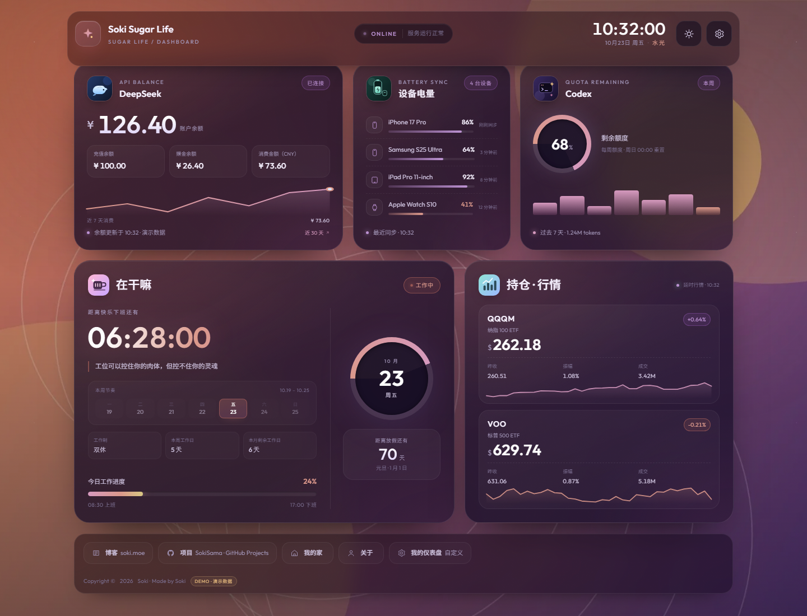
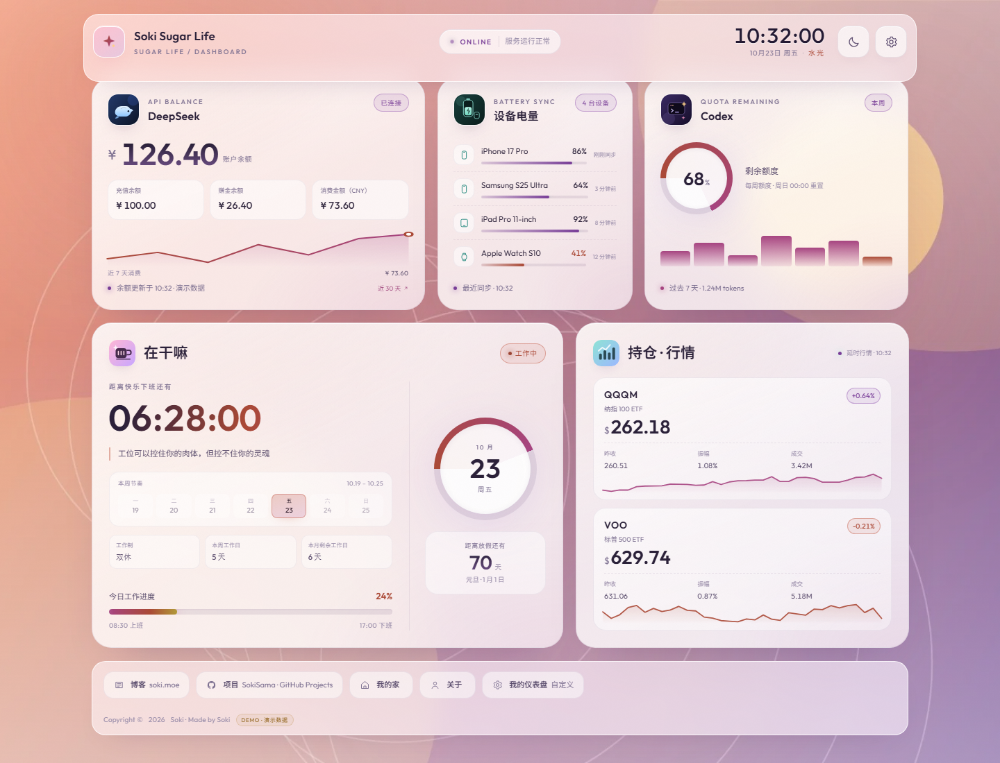
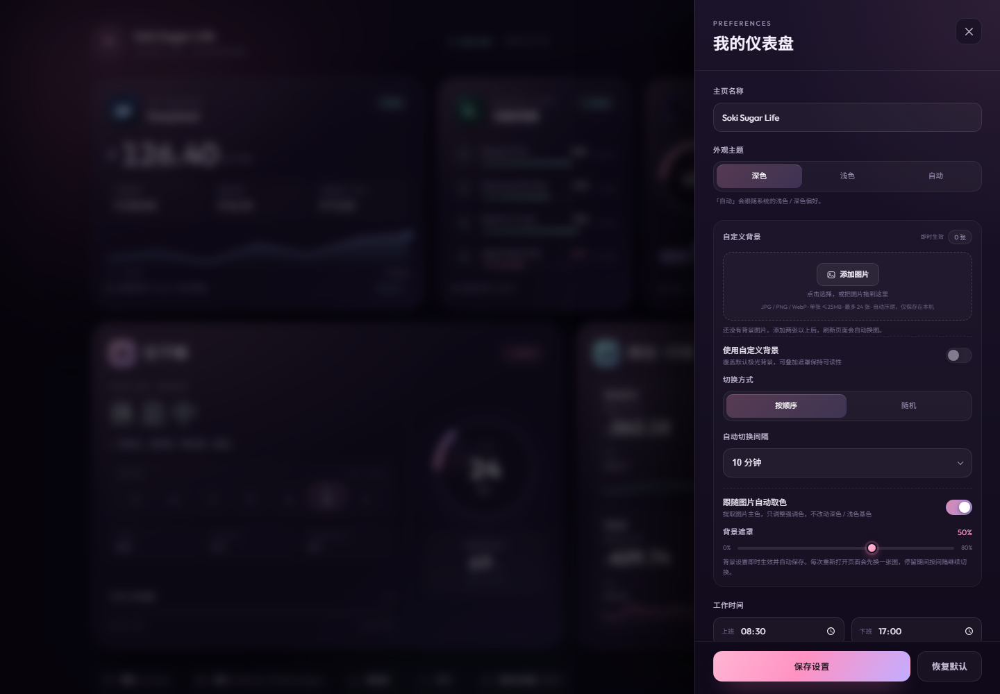
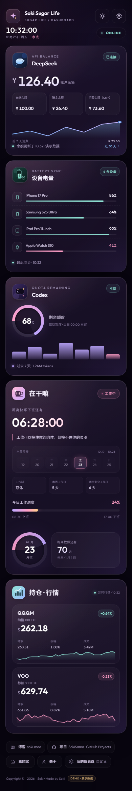

# Soki Sugar Life · Dashboard

一个玻璃质感的个人仪表盘，参考 [nozoki.soki.moe](https://nozoki.soki.moe/) 的信息结构与内容分区重新实现。自带深色 / 浅色 / 跟随系统三种外观，支持本地上传自定义背景、顺序 / 随机轮换，以及根据背景图片自动提取强调色。纯原生 HTML / CSS / JavaScript，无框架、无构建步骤，打开即用。

| 深色模式 | 浅色模式 |
| --- | --- |
|  |  |

## 已实现的功能

- **双主题外观**：深色 / 浅色 / 跟随系统；右上角 ☀/☾ 一键切换，设置抽屉里可精确选择。首屏在绘制前恢复主题，刷新不闪屏。
- **自定义背景**：本地上传多张图片，按顺序或随机自动轮换；每次重新进入网站先换一张，停留期间按设定间隔继续切换。图片只保存在当前浏览器。
- **图片取色主题**：从当前背景提取主色，自动替换强调色、光晕和图表颜色；深色 / 浅色的基色、卡片和文字配色保持不变，可随时关闭。
- **加密实时数据**：GitHub Actions 定时抓取 DeepSeek 余额与行情，设备/Codex 可通过 dispatch 上报；数据使用 AES-256-GCM 加密后部署，打开站点输入口令解密。详见 [GITHUB_PAGES_LIVE.md](GITHUB_PAGES_LIVE.md)。
- **实时时钟**：按北京时间（UTC+8）显示日期、星期与「水光」标记，每秒刷新。
- **在干嘛 · 工作状态**：上班 / 工作中 / 已下班 / 休息日四种状态，自动计算距离下班或上班的倒计时、今日工作进度、本周节奏、本月剩余工作日、距离下一个节假日的天数。
- **DeepSeek 卡片**：账户余额、充值余额、赠金余额、近 30 天消费、7 日消费趋势与平台明细入口。
- **设备电量**：四台设备的电量条、百分比、同步时间；低电量自动变成粉色。
- **Codex 卡片**：剩余额度环图、重置周期、近 7 天 Token 活动柱状图。
- **持仓 · 行情**：QQQM / VOO 的价格、涨跌幅、昨收、振幅、成交量与迷你走势图。
- **我的仪表盘设置抽屉**：主页名称、外观主题、自定义背景、上下班时间、双休 / 单休、博客地址、GitHub 地址、卡片不透明度（实时预览）、星光彩蛋、关闭加载与切换动画。设置抽屉**只在实时数据模式解锁后**才能打开和修改；演示数据模式下按钮禁用。
- **自动保存 / 跨设备同步**：设置修改后自动保存，不需要点「保存设置」；配置了 `SETTINGS_SYNC_TOKEN` 后，设置会随加密实时数据同步到其他设备。背景图片仍只保存在当前浏览器。
- **设置同步边界**：实时数据和演示数据共用同一套设置；只有「数据」区分 live / demo，设置不区分。演示模式不能修改设置。
- **响应式与可访问性**：桌面 / 平板 / 手机布局，键盘焦点管理、Esc 关闭、`prefers-reduced-motion`、跳过导航链接。
- **原创素材**：所有头像、标题图标均由手写 SVG 绘制；玻璃卡片、极光、星空与颗粒质感均由 CSS 实现。

| 自定义背景 · 深色 | 自定义背景 · 浅色 |
| --- | --- |
|  |  |

| 设置抽屉（深色） | 手机端（深色） |
| --- | --- |
|  |  |

浅色设置与浅色手机预览：[设置抽屉](preview-light-settings.png) · [手机端](preview-light-mobile.png)

背景设置与带背景的手机端：[背景设置](preview-wallpaper-settings.png) · [手机端](preview-wallpaper-mobile.png)

## 快速开始

```bash
cd nozoki-dashboard
node serve.mjs
```

然后访问 <http://127.0.0.1:4173>。

也可以直接双击 `index.html` 打开，或放到任意静态服务器上。`serve.mjs` 是零依赖的本地静态服务器，仅用于预览。

## 主题

- 右上角的 ☀/☾ 按钮在深色与浅色之间切换；**只有实时数据解锁后才可用**，选择会自动保存并参与跨设备同步。
- 设置抽屉 → **外观主题** → 深色 / 浅色 / 自动；「自动」跟随系统的 `prefers-color-scheme`，系统主题变化时会实时切换。
- 默认是深色。主题保存在 `sugar-dashboard:settings:v1` 的 `theme` 字段里，值为 `dark` / `light` / `auto`。
- 首屏主题由 `<head>` 里的内联脚本在 CSS 绘制前恢复，避免刷新时闪白或闪黑；`meta[theme-color]` 也会同步更新。
- 想新增第三套配色：复制 `css/style.css` 末尾的 `html[data-theme="light"]` 块并改成自己的 `data-theme`，同时在 `js/app.js` 的 `THEME_MODES`、`<head>` 内联脚本和设置抽屉里加入新选项即可。

## 自定义背景

设置抽屉 → **自定义背景**：

1. **添加图片**：点击「添加图片」多选，或把图片拖进虚线框。第一次添加会自动启用背景。
2. **使用自定义背景**：开启后替换默认极光背景；页头和页脚会自动加一层玻璃底，保证文字可读。
3. **切换方式**：按顺序（添加顺序循环）或随机（避免连续重复）。
4. **自动切换间隔**：1 / 5 / 10 / 30 / 60 分钟。每次重新打开页面都会先换一张，停留期间再按这个间隔继续切换。
5. **跟随图片自动取色**：从当前背景提取最多 4 个主色，替换强调色、卡片光晕、环形图和图表颜色；深色 / 浅色的基色、卡片和文字颜色不变。旁边的色块就是当前取到的 4 个颜色，可以随时关闭。
6. **背景遮罩**：0–80%，默认 50%。越高文字越清楚，越低图片越鲜艳。

背景相关设置**即时生效并自动保存**，不需要点「保存设置」；主表单的其他设置也会自动保存。设置抽屉只在实时数据解锁后可打开。

### 存储与限制

- 图片在浏览器里通过 Canvas 压缩后存入 **IndexedDB**，长边最大 2560px；另外生成 420px 缩略图。单张不超过 25MB，最多 24 张。
- 所有处理都在本机完成，**图片不会上传到任何服务器**。
- 图片只在当前浏览器 / 用户配置中有效；换浏览器、清理站点数据或使用隐私模式后会丢失。设置偏好会随加密实时数据同步，但图片文件需要跨设备请自行接入对象存储。
- 顺序 / 随机、间隔、遮罩、取色偏好保存在 `localStorage`；最后一张图片的 ID 单独记录，用来保证每次重新进入都会换一张。
- 推荐用 `node serve.mjs` 打开页面：部分浏览器对 `file://` 下的 IndexedDB 有限制。

## 目录结构

```
nozoki-dashboard/
├── index.html              # 页面结构
├── css/
│   └── style.css           # 全部样式、响应式与动画
├── js/
│   ├── data.js             # 演示数据、节假日、文案
│   ├── backgrounds.js      # 本地图片压缩、IndexedDB、主色提取
│   └── app.js              # 时钟、状态计算、渲染、设置抽屉、背景轮换
├── assets/                 # 原创 SVG 头像、标题图标、favicon
├── serve.mjs               # 本地预览服务器（零依赖）
├── package.json
├── LIVE_DATA.md            # 接真实数据的完整说明
├── GITHUB_PAGES_LIVE.md    # 本仓库的加密实时数据方案
├── .github/workflows/      # Pages 部署 + 行情/设备/Codex 更新
├── scripts/                # 数据抓取、加密、dispatch 工具
└── preview-*.png
```

## 改成你自己的

| 想改什么 | 改哪里 |
| --- | --- |
| 品牌名 / 主题副标题 | `js/data.js` 的 `site`，或设置抽屉里的「主页名称」 |
| 上下班时间 / 双休单休 | 设置抽屉，或 `js/data.js` 的 `work` |
| 余额、电量、额度、行情 | `js/data.js` 对应字段 |
| 节假日 | `js/data.js` 的 `holidays`，日期格式 `YYYY-MM-DD` |
| 页脚博客 / GitHub 链接 | 设置抽屉（只改链接，文案在 `index.html` 页脚） |
| 文案与结构 | `index.html` |
| 深色配色 | `css/style.css` 顶部的 `:root` 变量 |
| 浅色配色 | `css/style.css` 末尾的 `html[data-theme="light"]` 块 |
| 默认主题 | `js/app.js` 的 `DEFAULTS.theme` |
| 背景默认开关 / 顺序 / 间隔 / 取色 | `js/app.js` 的 `DEFAULTS.bg*` |
| 图片大小、压缩尺寸、数量上限 | `js/backgrounds.js` 的 `MAX_FILE_BYTES`、`MAX_EDGE`、`THUMB_EDGE`；`js/app.js` 的 `MAX_BG_IMAGES` |
| 图片取色规则 | `js/backgrounds.js` 的 `extractPalette`、`js/app.js` 的 `buildImagePalette` |
| 有背景时的页头 / 页脚玻璃底 | `css/style.css` 的 `html.has-wallpaper` 相关规则 |
| 颜色、圆角、字体、布局 | `css/style.css` |

### 关于演示数据

页面中的余额、设备电量、Codex 额度与行情都来自 `js/data.js` 的静态演示值，不会发起任何请求；页脚有 `DEMO · 演示数据` 标记。想要真实数据，建议用一个自己的后端聚合接口，前端只读取脱敏后的结果——**不要把 DeepSeek API Key、Codex 凭据等敏感信息直接写进前端**。

完整的接法（DeepSeek 余额、消费账本、行情、设备上报、Codex 采集、安全清单和前端 live 模式）见 **[LIVE_DATA.md](LIVE_DATA.md)**；本仓库已经接好的 GitHub Pages + 加密实时数据方案见 **[GITHUB_PAGES_LIVE.md](GITHUB_PAGES_LIVE.md)**。

可以按下面的形状准备接口，然后把 `js/data.js` 里的静态字段替换成接口返回值：

```json
{
  "deepseek": { "balance": 126.4, "recharge": 100, "bonus": 26.4, "spend": 73.6 },
  "devices": [{ "name": "iPhone 17 Pro", "level": 86, "icon": "phone", "state": "刚刚同步" }],
  "codex": { "remaining": 68, "reset": "每周额度 · 周日 00:00 重置", "tokens7d": 1236000 },
  "market": {
    "symbols": [
      { "symbol": "QQQM", "name": "纳指 100 ETF", "price": 262.18, "prevClose": 260.51, "amplitude": 1.08, "volume": "3.42M" }
    ]
  }
}
```

## 部署

整个目录就是静态站点，不需要构建：

- **GitHub Pages（仓库已内置）**：`.github/workflows/deploy.yml` 会在 push / 每 30 分钟 / 手动 / repository_dispatch 时生成加密数据并部署。添加 `DEEPSEEK_API_KEY`、`LIVE_DATA_PASSPHRASE` 与 `SETTINGS_SYNC_TOKEN` 三个 Secrets 后即可看到实时数据并让设置跨设备同步，步骤见 [GITHUB_PAGES_LIVE.md](GITHUB_PAGES_LIVE.md)。
- **Vercel / Netlify**：把 `nozoki-dashboard` 目录拖进部署面板即可（注意：这些平台不会自动运行本仓库的 GitHub Actions）。
- **GitHub Pages（手写）**：推送到仓库，在 Settings → Pages 选择 Actions 或分支根目录。
- **任意服务器 / 对象存储**：上传目录，入口为 `index.html`。

## 说明

- 时间固定按 `Asia/Shanghai` 计算；换时区可改 `js/data.js` 的 `work.timeZone`。
- 节假日只包含常见公历日期，**没有处理调休**；休息安排也只按「双休 / 单休」的周末规则计算。需要完整调休可扩展 `holidays` 与 `isRestDay()`。
- 「跟随节假日调休」是设置项里的说明文案，不会自动同步国务院放假安排。
- 字体通过 Google Fonts 加载 `Outfit` 与 `Noto Sans SC`，加载失败时会回退到系统字体（PingFang SC / HarmonyOS Sans / Microsoft YaHei）。
- 主题切换默认带 0.36s 颜色过渡；开启「关闭加载与切换动画」或系统开启减少动态效果时会立即切换。
- 背景图片和背景图片文件都是本地数据；部署后的站点不会自带示例背景，需要每个访客自行添加。背景偏好（顺序、间隔、遮罩、取色）属于设置，会参与跨设备同步。
- 图片取色只覆盖强调色与光晕，不会改变深色 / 浅色主题的基底，因此切换深色 / 浅色时取色结果会按对应明暗重新计算一次。
- 行情为演示值，不构成任何投资建议。
- 本项目是对原站布局与信息组织的练习性复刻，**未复制原站代码或图片**；品牌名、页脚署名沿用原站仅用于还原观感，若作为自己的站点使用，请替换为你的名字、头像与链接。仅供学习与个人使用。

原始参考：[soki.moe](https://soki.moe/) · [nozoki.soki.moe](https://nozoki.soki.moe/)
